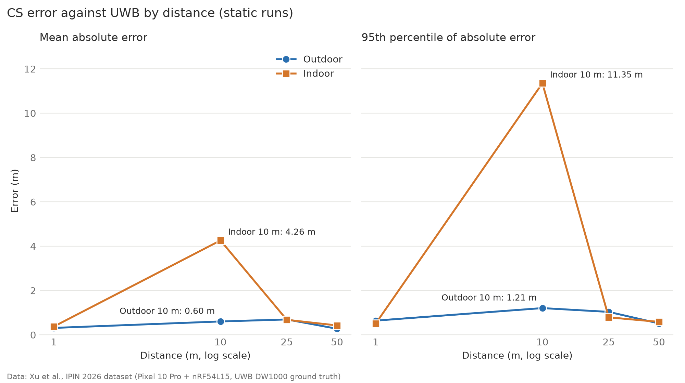
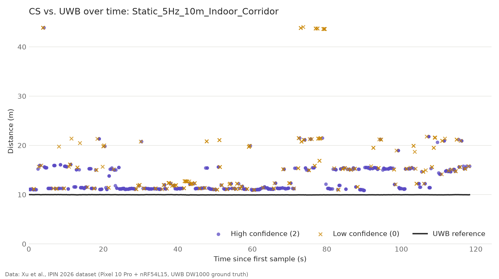
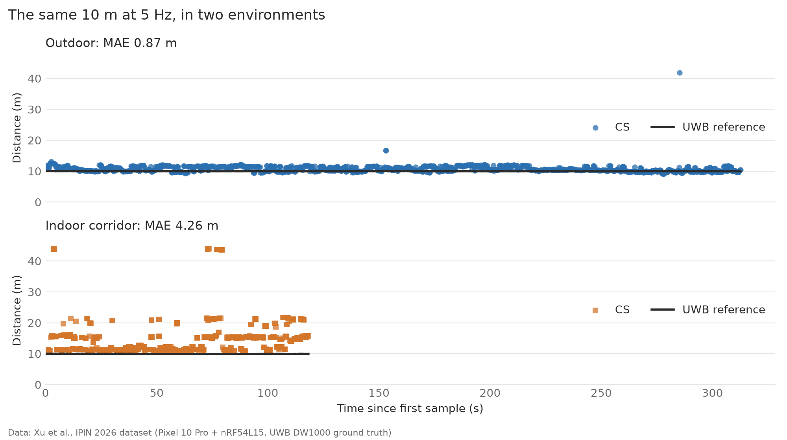
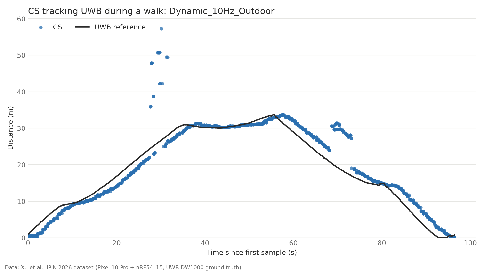

# Bluetooth Channel Sounding Data Analysis

**Information Communication (DCCS 206), Korea University · Team A3**

**Team members:** 전재형, 최연우, 김영웅

**Project title:** *From Flagship-Only to Everywhere: Bluetooth Channel Sounding and the Evolution of Precise Short-Range Ranging*

**Category:** Close range — the things you touch

This repository contains our analysis of a public measurement dataset, used to produce the figures in our presentation. With the professor's approval, the project is research-based: we did not run our own experiments, and all measurements come from the published dataset credited below.

## Research context

Our presentation follows the evolution of short-range ranging:

| Technology | Strengths | Limitations |
|---|---|---|
| RSSI | Inexpensive | Inaccurate; vulnerable to relay attacks |
| UWB | Centimeter-level ranging; secure | Requires a dedicated chip; largely limited to flagship devices |
| Channel Sounding (CS) | No dedicated chip; uses Bluetooth alone | Accuracy is the question this analysis examines |

**Our question:** Apple pioneered UWB in phones, yet it added Bluetooth Channel Sounding in iOS 27 — and Samsung's SmartTag3 now ships with both. Is Channel Sounding a replacement for UWB, or the start of a division of labor between them?

**Working conclusion:** a division of labor in the short term, with partial replacement in the low-cost device market. The results below serve as evidence for this question and for the course's common question on what was given up.

## Dataset

Xu et al., [Bluetooth 6.0 Channel Sounding Ranging Dataset](https://github.com/RuijieXu0408/Bl-CS-Evaluation-Dataset), accompanying the paper "Beyond Proximity: Evaluating High-Precision Bluetooth Channel Sounding for Mobile Applications," accepted to IPIN 2026. The dataset is licensed under CC BY 4.0. We link to it rather than redistribute it, so it is not committed to this repository.

| Component | Specification |
|---|---|
| Initiator | Google Pixel 10 Pro (Android 16, Bluetooth 6.0) |
| Reflector | Nordic nRF54L15 DK |
| Reference | Qorvo DW1000 UWB modules, mechanically co-located with the Bluetooth antennas |
| Band | 2.4 GHz ISM, up to 72 channels |
| Update rates | 0.2 Hz, 5 Hz, 10 Hz |
| Environments | Outdoor grassland (60 m × 30 m, line of sight); indoor corridor (2.5 m wide, multipath-rich) |

## Method

Each CS sample is paired with the nearest UWB sample in time, with a maximum tolerance of 500 ms. This is the alignment described by the dataset authors. Error is defined as CS − UWB, in meters.

The implementation is in [`scripts/align.py`](scripts/align.py). For `Static_5Hz_10m_Indoor_Corridor`, the CS log covers about 2 minutes and the UWB log about 9 minutes. The dataset authors state this difference is intentional, and UWB samples outside the CS interval are left unmatched.

## Results: static measurements

The table covers 13 static scenarios and 16,589 aligned samples. "95%" is the 95th percentile of absolute error. All values except n are in meters.

| Scenario | Environment | Distance (m) | n | Mean error | MAE | Std. dev. | 95% | RMSE |
|---|---|---:|---:|---:|---:|---:|---:|---:|
| `Static_5Hz_1m_Indoor_Corridor` | Indoor | 1 | 1734 | -0.37 | 0.37 | 0.10 | 0.50 | 0.38 |
| `Static_5Hz_10m_Indoor_Corridor` | Indoor | 10 | 704 | 4.26 | **4.26** | 5.32 | **11.35** | 6.81 |
| `Static_5Hz_25m_Indoor_Corridor` | Indoor | 25 | 1889 | 0.68 | 0.68 | 0.08 | 0.79 | 0.68 |
| `Static_5Hz_50m_Indoor_Corridor` | Indoor | 50 | 2040 | -0.42 | 0.42 | 0.12 | 0.59 | 0.43 |
| `Static_10Hz_1m_Outdoor` | Outdoor | 1 | 1669 | -0.20 | 0.28 | 0.28 | 0.68 | 0.34 |
| `Static_5Hz_1m_Outdoor` | Outdoor | 1 | 897 | 0.36 | 0.37 | 0.15 | 0.57 | 0.39 |
| `Static_02Hz_10m_Outdoor` | Outdoor | 10 | 354 | 0.07 | 0.20 | 0.27 | 0.66 | 0.28 |
| `Static_10Hz_10m_Outdoor` | Outdoor | 10 | 2167 | 0.43 | 0.51 | 0.35 | 0.87 | 0.56 |
| `Static_5Hz_10m_Outdoor` | Outdoor | 10 | 1306 | 0.79 | 0.87 | 1.16 | 1.91 | 1.40 |
| `Static_10Hz_25m_Outdoor` | Outdoor | 25 | 1724 | 0.47 | 0.50 | 0.60 | 0.82 | 0.76 |
| `Static_5Hz_25m_Outdoor` | Outdoor | 25 | 1393 | 0.94 | 0.94 | 1.74 | 1.30 | 1.98 |
| `Static_10Hz_50m_Outdoor` | Outdoor | 50 | 524 | 0.26 | 0.31 | 0.41 | 0.54 | 0.48 |
| `Static_5Hz_50m_Outdoor` | Outdoor | 50 | 188 | 0.10 | 0.17 | 0.18 | 0.44 | 0.21 |

**Preliminary observations**

- Outdoors, MAE stays between about 0.2 m and 0.9 m from 1 m to 50 m. In these conditions, CS differs from UWB by tens of centimeters rather than single centimeters.
- The indoor corridor at 10 m is the clear outlier (MAE 4.26 m, 95th percentile 11.35 m). The other indoor distances have an MAE of 0.37–0.68 m. The next section looks at this run over time.
- Outdoors at 10 m and 25 m, the 5 Hz runs show larger errors than the 10 Hz runs. We have not determined why, so we do not draw a conclusion from this.
- Each n counts every aligned row. Across the 13 scenarios, 0–55% of rows repeat the previous value within 5 ms. Removing these repeats changes MAE by at most 0.07 m, so the observations above do not depend on them.



Figure A combines update rates at each distance using an n-weighted average of the per-run values. The combined 95% value is therefore an average of percentiles, not a percentile of the pooled samples.

## Results: the indoor 10 m outlier



- **The errors jump between levels.** UWB stays within 9.93–10.02 m, while CS readings cluster near 11, 15, 21, and 44 m rather than spreading evenly. CS reads higher than UWB in all 704 samples, by at least 0.90 m.
- **The errors change over time.** The median error is 1.32 m for the first 70 s, 11.19 m from 70 to 80 s, and 5.25 m from 80 s to the end, although both devices were static.
- **Confidence level helps only partly.** Low-confidence samples make up 72% of errors of 10 m or more, compared with 17% of errors under 2 m. High-confidence samples can still be far off, with a maximum error of 33.92 m.

Positive jumps between distinct levels are consistent with multipath, where a longer reflected path could be measured instead of the direct one. This is our hypothesis: the Android API does not expose the raw data needed to test it, and this is a single recording.

Figure B compares this run with the outdoor run at the same distance and update rate. The outdoor log is longer, and it is shown in full so that its two largest deviations stay visible.



## Results: walking



Figure C shows one linear outdoor walk. The table lists all eight walking scenarios so that it can be read in context. Values are in meters, except n and lag.

| Scenario | n | Median abs. error | MAE | 95% | Best-fit lag (s) | Median abs. error at that lag |
|---|---:|---:|---:|---:|---:|---:|
| `Dynamic_10Hz_Indoor_Corridor` | 879 | 2.80 | 2.59 | 4.42 | 2.9 | 0.43 |
| `Dynamic_5Hz_Indoor_Corridor` | 551 | 2.32 | 2.50 | 4.83 | 3.2 | 0.69 |
| `Dynamic_10Hz_Outdoor` | 1190 | 1.99 | 2.47 | 10.25 | 2.7 | 0.28 |
| `Dynamic_5Hz_Outdoor` | 609 | 2.15 | 4.69 | 32.98 | 2.9 | 0.35 |
| `Dynamic_10Hz_Outdoor_backforth` | 576 | 2.86 | 3.66 | 16.91 | 2.9 | 0.33 |
| `Dynamic_5Hz_Outdoor_Backforth` | 269 | 2.82 | 4.77 | 18.81 | 2.9 | 0.28 |
| `Dynamic_10Hz_Outdoor_Swing` | 1106 | 2.18 | 2.23 | 4.53 | 2.8 | 0.27 |
| `Dynamic_5Hz_Outdoor_Swing` | 531 | 2.10 | 1.99 | 3.86 | 3.0 | 0.21 |

- **CS follows the shape of the walk, but later.** CS reads below UWB while the distance grows and above it while the distance shrinks. Comparing each CS sample with UWB from about 3 s earlier (2.7–3.2 s across all eight runs) lowers the median absolute error from 1.99–2.86 m to 0.21–0.69 m.
- **We cannot tell where this lag comes from.** It could be smoothing or latency in the Android API, or an offset between the two logs' clocks, and the dataset documentation does not address it. The lag was fitted to the same data it is evaluated on, so the lag-adjusted values are optimistic. It should not be presented as a measured CS latency.
- **Large deviations remain.** Some runs have a 95% error above 10 m, including Figure C, where readings reach 57 m around the 30 s mark.
- **Static results are not affected by the same mechanism.** The UWB distance is nearly constant in those runs, so a time shift would change their errors very little.

## Limitations

1. **The reference is also a measurement.** UWB has its own error, so these results show how far CS differs from UWB, not its absolute accuracy.
2. **We did not collect this data.** Our contribution is the analysis of the public dataset by Xu et al.
3. **The sample is small.** The dataset has one recording per scenario, so the results apply to these experimental conditions and should be generalized with caution.
4. **Confidence levels are not error probabilities.** The dataset authors note that the Android API's categorical confidence level is not a calibrated error probability.

Comarch's office tests also report steadier readings from UWB than from CS [5]. This points in the same direction as our results, although the setups differ.

## Reproducing the setup

```bash
git clone https://github.com/JBR-313/Team_A3_IC_project.git
cd Team_A3_IC_project
git clone --depth 1 https://github.com/RuijieXu0408/Bl-CS-Evaluation-Dataset data/

python3 -m venv .venv
source .venv/bin/activate
pip install -r requirements.txt
```

## Repository layout

```
├── requirements.txt
├── data/                   # Dataset clone (not committed)
├── scripts/
│   ├── align.py            # Loads a scenario and aligns CS with UWB
│   ├── static_error.py     # Static statistics table and Figure A
│   ├── style.py            # Shared figure style
│   └── timeseries.py       # Indoor 10 m check, walking statistics, Figures B and C
└── figures/                # Slide figures (PNG)
```

Scripts run as `python scripts/<name>.py --data data --out figures`.

## References

1. M. Woolley, "Bluetooth Channel Sounding: A Technical Overview," v1.0, Bluetooth SIG, Jul. 2024. https://www.bluetooth.com/channel-sounding-tech-overview/
2. Apple, "Find your accessory with Bluetooth Channel Sounding," WWDC26 Session 369. https://developer.apple.com/videos/play/wwdc2026/369/
3. Nordic DevZone, "Evaluating Bluetooth Channel Sounding with our open-source Android app on Google Pixel 10." https://devzone.nordicsemi.com/nordic/nordic-blog/b/blog/posts/evaluating-bluetooth-channel-sounding-with-our-open_2d00_source-android-app-on-google-pixel-10
4. Android Developers, "Range between devices." https://developer.android.com/develop/connectivity/ranging
5. Comarch, "UWB vs Bluetooth Channel Sounding – which is better for distance measurements?," 2025. https://www.comarch.com/sw-and-hw-services/blog/uwb-vs-bluetooth-channel-sounding-which-is-better-for-distance-measurements/
6. ZDNet Korea, article on the Galaxy SmartTag3, Oct. 1, 2026. https://zdnet.co.kr/view/?no=20261001095757
7. JoongAng Economy News (중앙이코노미뉴스), article on the Galaxy SmartTag3, Oct. 1, 2026. https://www.joongangenews.com/news/articleView.html?idxno=551782
8. R. Xu, P. Xu, C. Chang, T.-H. Hsu, and L.-T. Hsu, "Beyond Proximity: Evaluating High-Precision Bluetooth Channel Sounding for Mobile Applications," in Proc. IPIN, 2026 (to appear). Dataset: https://github.com/RuijieXu0408/Bl-CS-Evaluation-Dataset

**Correction to our proposal:** reference [8] in the proposal used the title "From Proximity to Precision…", taken from the GitHub repository description. This README uses the title given in the dataset's own README. The UWB reference module is the DW1000, not the DW3000.

## AI use disclosure

The analysis plan, code, and this README were written with assistance from Claude (Anthropic), as disclosed under the course's rules on AI use. All team members are expected to be able to explain the alignment method and limitations described above.
